# Conjunction screening for a LEO digital twin

**Interdisciplinary project** · RV College of Engineering, Bengaluru · 6th semester, 2025–26 · team EN15

This is the aerospace half of a four-person project: an energy-aware digital twin
of satellite constellations in low Earth orbit. Two of us came from Aerospace
Engineering and two from Information Science. The aerospace side supplied the
orbital data and the analysis in AGI's Systems Tool Kit (STK) that the software
side builds on: propagation, access windows and conjunction screening.

> **The digital twin itself is my teammates' work.** Khushi Choudki and Keerthi M built
> it: a Rust N-body engine, collision-risk scoring, evasion and energy models, and a 3D
> interface. It lives in
> **[their repository](https://github.com/KhushiChoudki/Energy-Aware-Digital-Twin-of-LEO-Satellite-Constellations-Using-Scalable-N-Body-Simulation-)**.
> This repository covers the orbital mechanics: our final STK screening of 33
> satellites, and open-source code that checks every number STK gave us.

<p align="center">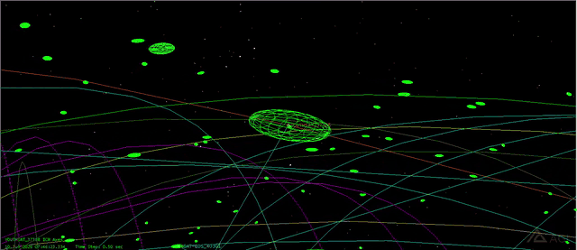<br>
<sub>STK, 10 July 2026: following YOUTHSAT through a field of safety ellipsoids during the
conjunction screening. <a href="media/stk-youthsat-conjunction.mp4">Full recording (47 s)</a></sub></p>

---

## The short version

1. **Free, open-source SGP4 reproduces STK to the millimetre.** For all 33 satellites
   in our final scenario, the `sgp4` and Skyfield packages reproduce the ephemeris
   STK stored, 1,441 points each. The worst difference is 1.3 mm.
2. **AdvCAT's close-approach report, decoded and reproduced.** *Min Separation* is
   the gap between the two safety ellipsoids. *Time In* and *Time Out* are when that
   gap crosses the 10 km threshold. *Intersect* means the ellipsoids overlap.
   With those definitions, a screener written from scratch here finds exactly the
   events STK found between scenario satellites. Ranges and gaps agree to 1 mm,
   times to 0.4 ms.
3. **Our July 2026 screening ran on element sets from March 2017.** They were the
   newest in our STK 11.2 installation's database. Positions came out 4,000–14,000 km
   from where 2026 data puts the satellites. RISAT-2 re-entered the atmosphere in
   October 2022, yet in the scenario it flew 430 km *below* the Earth's surface
   and was screened for collisions.
   [Looking back](#looking-back-a-2017-sky-in-2026) explains how that happened.
4. **Redone with May 2026 element sets:** 743 close approaches in 24 hours for the
   18 scenario satellites still active. DUBAISAT-2, at 537 km, accounts for 232
   of them.
5. **The Iridium 33 / Cosmos 2251 debris, 17 years after the collision.** The
   Cosmos fragments' orbit planes are now spread all the way around the Earth. The
   Iridium fragments are still a band. The Earth's oblateness turns orbit planes 4.4
   times faster at the Cosmos inclination than at the Iridium one.

---

## Start here

- **[What the STK scenario contains](stk/README.md)**: the 33 satellites, AdvCAT's
  settings, and how to open it.
- **[What AdvCAT reports, exactly](theory/02-what-advcat-reports.md)**: safety
  ellipsoids, the contact function, and the definitions recovered here.
- **[TLEs and SGP4](theory/01-tles-and-sgp4.md)**: what an element set is, why
  open-source SGP4 matches STK, and what an element set's age costs.
- **[Debris clouds](theory/03-debris-clouds.md)**: how one collision becomes a shell
  of debris around the Earth.
- **[MISTAKES.md](MISTAKES.md)**: what went wrong, and what each mistake taught me.
- **[RESOURCES.md](RESOURCES.md)**: papers, data sources and software.

---

## The project

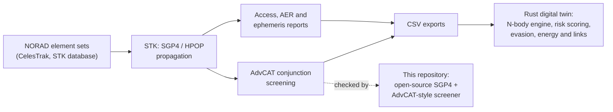

| | Who | What |
|---|---|---|
| **Information Science** | Khushi Choudki, Keerthi M | the Rust digital twin: Barnes–Hut N-body engine, debris generation, proximity-based risk scoring, evasion burns, energy and ground-station link models, wgpu/egui interface. [Their repository](https://github.com/KhushiChoudki/Energy-Aware-Digital-Twin-of-LEO-Satellite-Constellations-Using-Scalable-N-Body-Simulation-) |
| **Aerospace** | Tejas L, Akula Uday Kiran | STK scenarios, propagation, access and AER reports, AdvCAT screening, and the data handed to the software side |
| **Guide** | Dr. Rachana S Akki | Associate Professor, RV College of Engineering |

The aerospace work ran in three stages. In April–May 2026 we built a five-object
scenario: ISS Zarya, a polar satellite, a debris object, a Starlink satellite and
a small satellite. From it we exported the ISS ephemeris and its access and AER
reports against the debris object, and the Rust engine reads those files. We then
screened SWISSCUBE against STK's full catalogue. This repository covers the final
stage, the 33-satellite screening of July 2026, and everything learned by checking
it.

---

## The final scenario: 33 satellites, 24 hours

The scenario `Hope_2` covers 10 July 2026, 06:30 UTC, to 11 July 06:30. It holds
33 satellites, most of them sun-synchronous. 15 are Indian, from ASTROSAT and
the CARTOSAT series to the student satellites JUGNU, SRMSAT and SWAYAM; the other
18 are Earth-observation and small satellites in similar orbits.

AdvCAT, STK's conjunction tool, screened all 33 against each other and against
four STK catalogues of element sets. Each object carried a safety ellipsoid
measuring 20 km along its track, 10 km across it and 5 km radially. Events were
reported when two ellipsoids came within 10 km of each other.

<table>
<tr>
<td width="50%">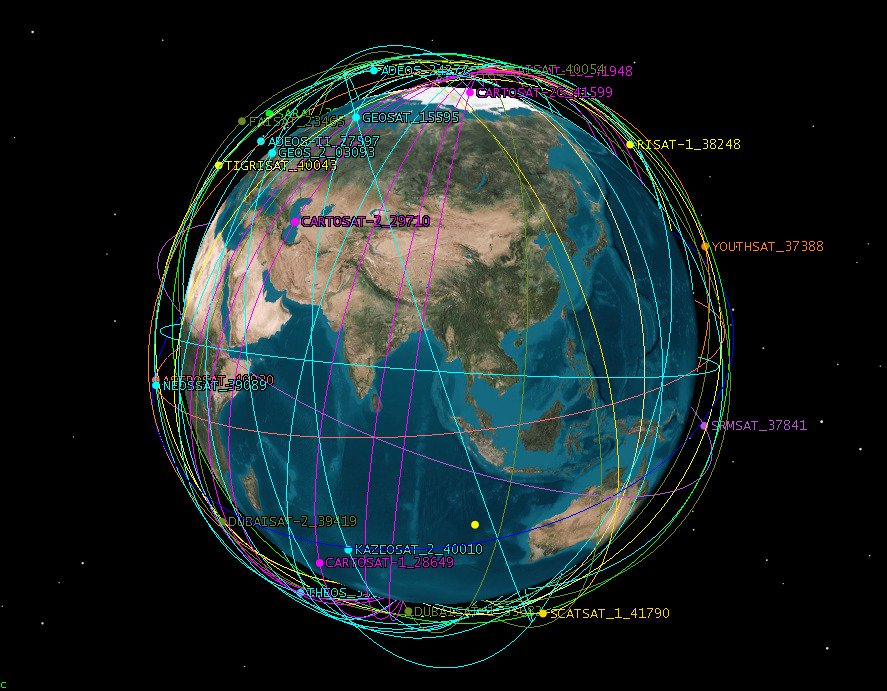</td>
<td width="50%">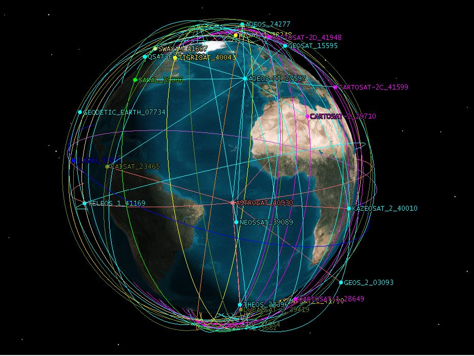</td>
</tr>
</table>

<p align="center">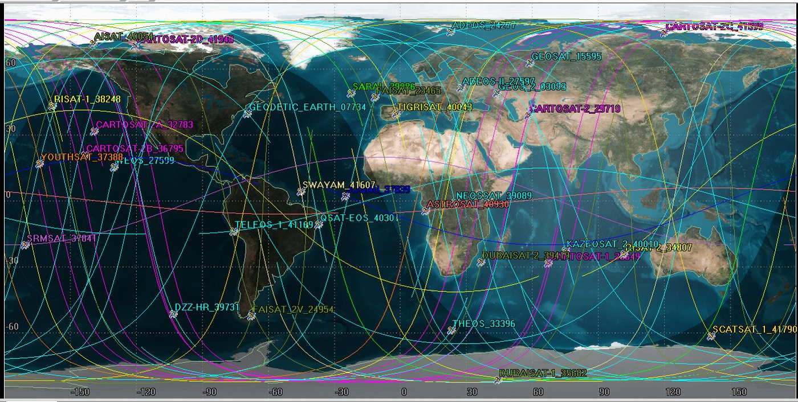<br>
<sub>Ground tracks of the 33 satellites over the 24-hour window. <a href="media/stk-globe.mp4">Globe view (14 s)</a></sub></p>

The screening produced 4,312 report rows. Many objects appear in more than one of
the four catalogues, so most events are listed two to four times; there are
1,955 distinct events, 683 of them with intersecting ellipsoids. The export went
to the software side as a CSV. It is in [`stk/`](stk/) with the full scenario.

AdvCAT colours each ellipsoid by state. The four frames below show YOUTHSAT's
closest event of the day, with an object catalogued as 39777: 1.79 km at closest
approach, Time In 07:45:49.902, Time Out 07:45:56.934. The frames line up with
those times. The ellipsoids are red at closest approach, yellow until Time Out,
and green once they are more than 10 km apart.

<table>
<tr>
<td width="50%">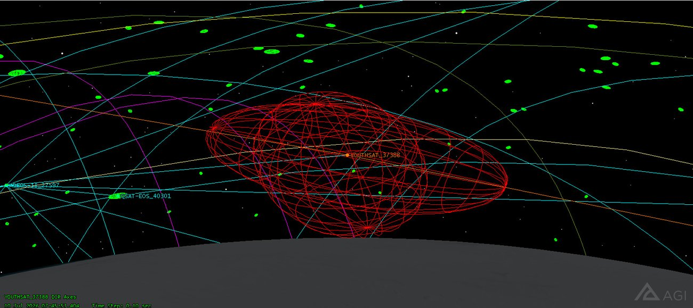<br><sub>07:45:53.4: closest approach, ellipsoids intersect (red)</sub></td>
<td width="50%">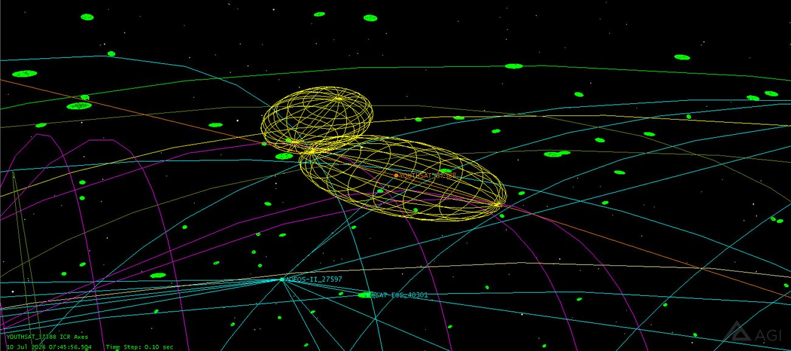<br><sub>07:45:56.5: separating, gap still under 10 km (yellow)</sub></td>
</tr>
<tr>
<td>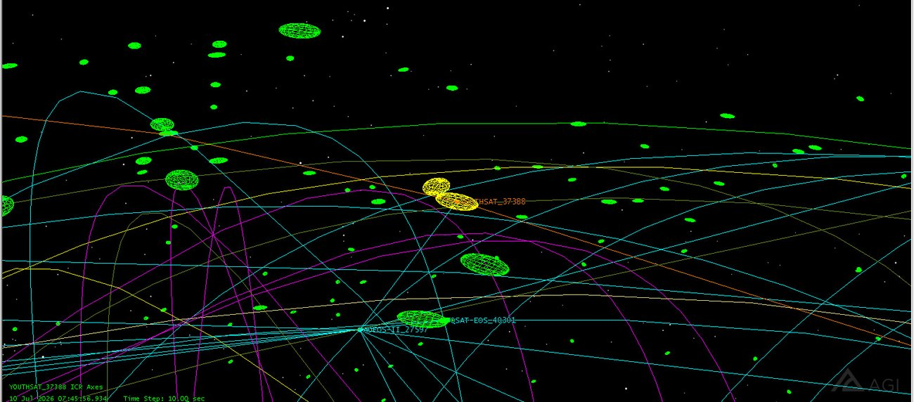<br><sub>07:45:56.9: Time Out, wider view (yellow)</sub></td>
<td>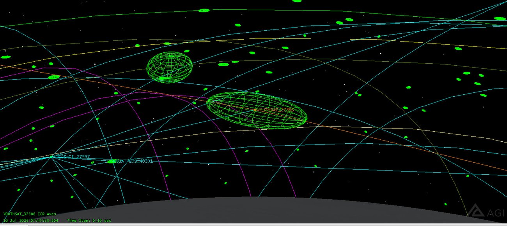<br><sub>07:45:58.6: more than 10 km apart (green)</sub></td>
</tr>
</table>

---

## Checking STK with open tools

STK is licensed software, and most of the people who might read a result like this
cannot rerun it. Each `.sa` file in the scenario stores the element set STK used
and the ephemeris it computed from it. This made it possible to check STK's
results with free tools.

**The ephemeris.** The `sgp4` package (Vallado's reference implementation) and
Skyfield's rotation from SGP4's TEME frame to ICRF reproduce all 33 stored
ephemerides. The largest difference over 47,553 points is **1.29 mm**.

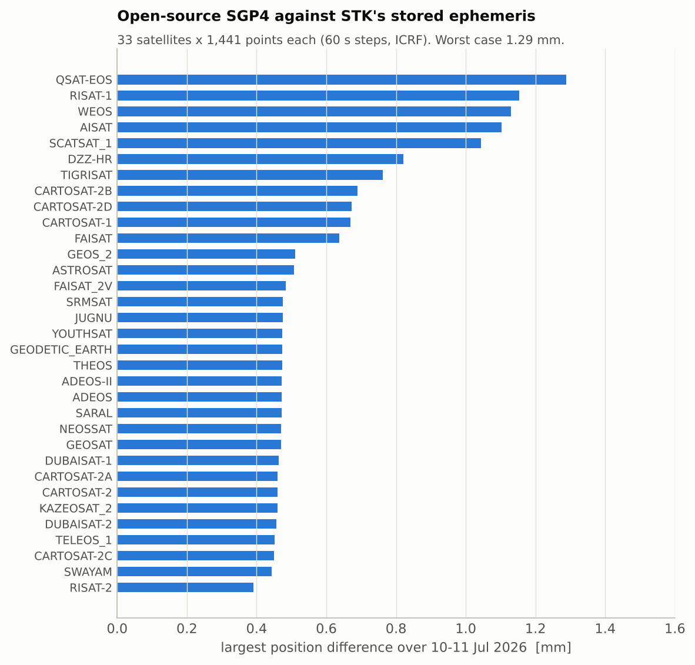

**The close approaches.** AdvCAT's report has three numbers per event, and the
report itself does not define them. The [`leo/`](leo/) package recovers them as
follows.

| Column | Meaning |
|---|---|
| Min Range | smallest centre-to-centre distance |
| Min Separation | smallest distance between the two ellipsoid surfaces, or "Intersect" if they overlap |
| Time In, Time Out | the two instants at which that surface distance equals the 10 km threshold |

[`analysis/validate_against_stk.py`](analysis/validate_against_stk.py) runs the
screener written here on the same 33 satellites, with the same ellipsoids,
threshold and window. It finds the three CARTOSAT-2 / ASTROSAT events AdvCAT
reported between scenario satellites, each listed once per primary, and nothing
else.

| Closest approach (UTC) | Min Range, STK | ours | Min Separation, STK | ours | Time In / Out |
|---|---|---|---|---|---|
| 06:45:10.6 | 14.668758 km | 14.668758 km | 1.068592 km | 1.068591 km | within 0.4 ms |
| 07:33:50.9 | 3.551351 km | 3.551351 km | Intersect | Intersect | within 0.3 ms |
| 09:11:10.1 | 30.368512 km | 30.368512 km | 1.200267 km | 1.200267 km | within 0.1 ms |

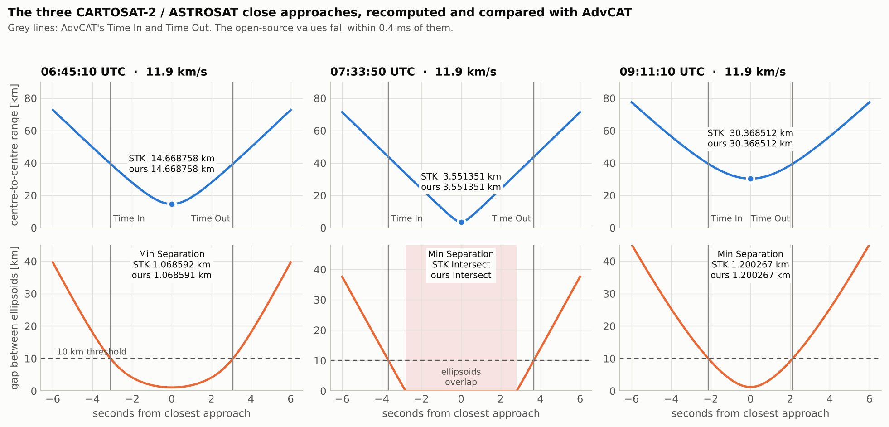

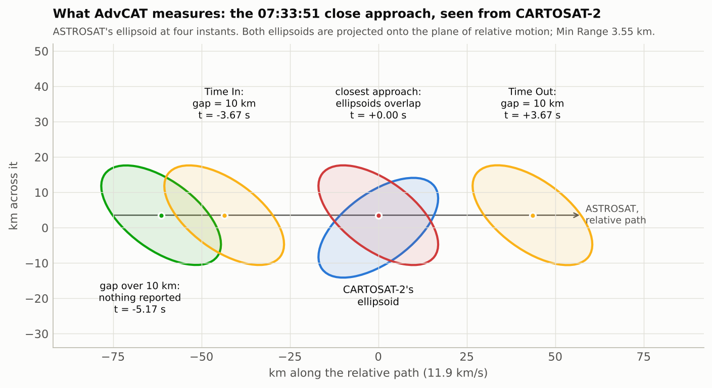

Both satellites crossed at 11.9 km/s, about the speed of the 2009 Iridium–Cosmos
collision (11.7 km/s). Because the encounter is that fast, each event lasts only
a few seconds.

---

## Looking back: a 2017 sky in 2026

The reproduction matches STK to the millimetre, which raised the next question:
did STK's positions match the sky? They did not.

STK propagates the element sets in its local database (`stkAllTLE.tce`), and the
newest sets in ours were from **28–29 March 2017**. Every position in our July 2026
scenario was propagated 9.3 years from those sets.

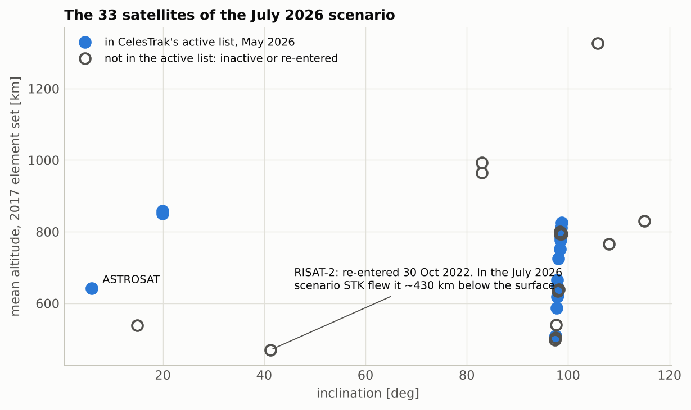

Eighteen of the 33 satellites appear in CelesTrak's active-satellite list from
May 2026, so their 2017 positions can be compared with the 2026 ones.
[`analysis/tle_age.py`](analysis/tle_age.py) puts both sets at the 2026 epoch:

- the 2017 sets put the satellites **4,056–13,925 km** from their 2026 positions
  (median 11,051 km);
- they are 33–170° out around the orbit, and the orbit planes differ by 3–97°;
- after nine years, the positions are no closer than random points on the orbit.

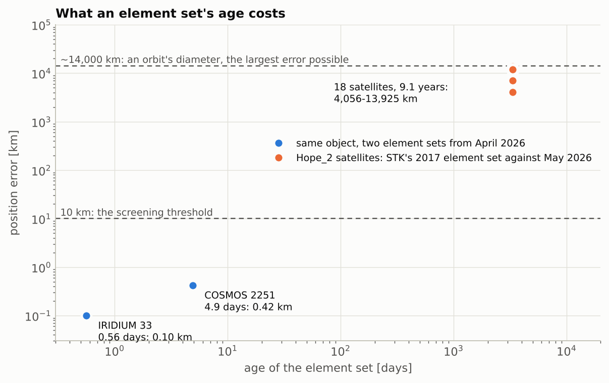

The other fifteen satellites are inactive or gone. **RISAT-2 re-entered over the
Indian Ocean on 30 October 2022.** From its 2017 element set, SGP4 reports it as
decayed (error code 6) from June 2024 on, and at every instant of our scenario.
STK computed the ephemeris anyway and AdvCAT screened it. The stored radius is
5,942–5,953 km, against the Earth's 6,357–6,378 km: **some 430 km underground**. The export's
events fall into 32 blocks for 33 primaries. That fits one primary having nothing
to meet, and a satellite flying underground would be that one.

So the July screening shows that the method works: the setup, the ellipsoids and
the reports are all right. The specific conjunctions it found are fiction. None of
them describes the sky of 10 July 2026, including the YOUTHSAT encounter in the
screenshots. For comparison, a COSMOS 2251 element set 4.9 days old is 0.42 km
off. That is the scale at which screening means something.

## The screening, redone with 2026 element sets

[`analysis/screen_2026.py`](analysis/screen_2026.py) runs the same screening,
with the same ellipsoids, threshold and definitions, on data that matches its date:

- **primaries**: the 18 scenario satellites with May 2026 element sets;
- **secondaries**: CelesTrak's active list plus the catalogued Cosmos 2251 and
  Iridium 33 debris, 15,909 objects, none of them more than seven days older than
  the window;
- **window**: 24 hours from 1 May 2026, 12:00 UTC, at the epoch of most of the
  element sets.

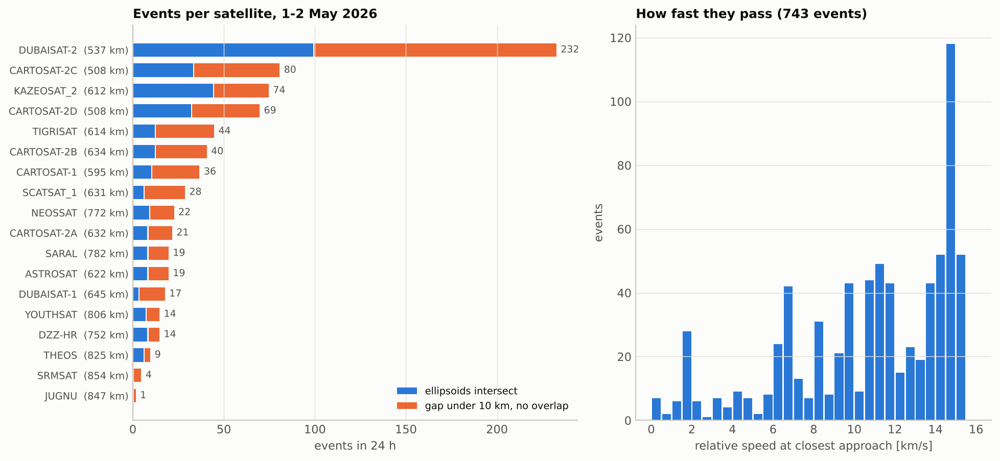

The screening found **743 events, 305 with intersecting ellipsoids**. The closest
was 1.26 km, between DUBAISAT-2 and YUNYAO-1 45 at 15.0 km/s. DUBAISAT-2 sits at
537 km, in the band crowded by the newest constellations. The four satellites
above 800 km have between 1 and 14 events each. Starlink satellites are the secondary in
230 events, Cosmos 2251 fragments in 89 and Kuiper satellites in 69.

The relative speeds peak near 15 km/s. Sun-synchronous orbits are slightly
retrograde at about 98°, so they meet the prograde shells almost head-on.

This catalogue has no inactive satellites, no rocket bodies, and no debris except
the two clouds, so 743 is a floor. Re-running DUBAISAT-2 with a 15 s step instead
of 60 s finds the same 232 events.

---

## The debris clouds of Iridium 33 and Cosmos 2251

On 10 February 2009 the two satellites collided at 789 km over Siberia. The
fragments of each stayed close to their parent's inclination: 74.0° for Cosmos,
86.4° for Iridium. [`analysis/debris_clouds.py`](analysis/debris_clouds.py) uses
the April 2026 element sets of every catalogued fragment, 585 Cosmos and 108
Iridium.

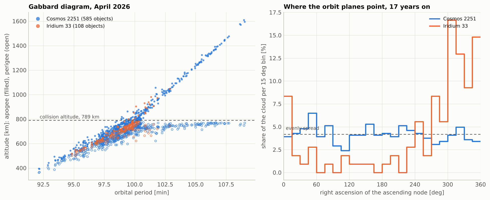

The Earth's oblateness (J2) turns every orbit plane at a rate proportional to
cos *i*, so the Cosmos planes turn 4.4 times faster than the Iridium ones.
Within each cloud, fragments thrown to different heights turn at slightly
different rates, and that spread fans the planes out. For the middle half of the
Cosmos fragments, a full 360° of fanning takes 9 years; for the Iridium fragments
it takes 40. Seventeen years on, the Cosmos planes point evenly in every direction:
a shell around the Earth. The Iridium planes still cluster: a band.
[Theory 03](theory/03-debris-clouds.md) has the details. The "debris bands" in the
digital twin's fragmentation model are this effect.

---

## What is here

```
leo-conjunction-screening/
├── leo/                    the open-source pipeline
│   ├── tle.py              element sets and the orbit quantities that follow from them
│   ├── propagate.py        SGP4 (TEME), and GCRS via Skyfield for the STK comparison
│   ├── stk.py              readers for STK satellites, the AdvCAT object and its CSV report
│   ├── ellipsoid.py        safety ellipsoids, contact function, surface gap
│   ├── screening.py        AdvCAT-style screening: filters, coarse pass, refinement
│   └── timeutil.py
├── analysis/               one script per result above
├── tests/test_leo.py       ten checks against STK, closed forms and known facts
├── make_figures.py         rebuilds every generated figure
├── stk/                    the full July 2026 scenario and AdvCAT's exported report
├── data/tle/               every element set used, with where it came from
├── data/results/           the outputs of the analysis scripts
├── figures/                generated figures and STK screenshots
├── media/                  the STK recordings and the team photo
└── theory/                 three notes on the physics
```

## Running it

```bash
pip install -r requirements.txt
python3 analysis/validate_against_stk.py   # SGP4 vs STK ephemeris; AdvCAT events reproduced   (~5 s)
python3 analysis/tle_age.py                # 2017 element sets against 2026                    (~2 s)
python3 analysis/screen_2026.py            # the 2026 screening, 18 x 15,909 objects           (~4 min)
python3 analysis/debris_clouds.py          # the two debris clouds                             (~1 s)
python3 make_figures.py                    # rebuilds the seven generated figures              (~15 s)
python3 tests/test_leo.py                  # ten checks                                        (~5 s)
```

To open the scenario itself you need STK 11 or later; see [`stk/README.md`](stk/README.md).

---

## Team

<p align="center">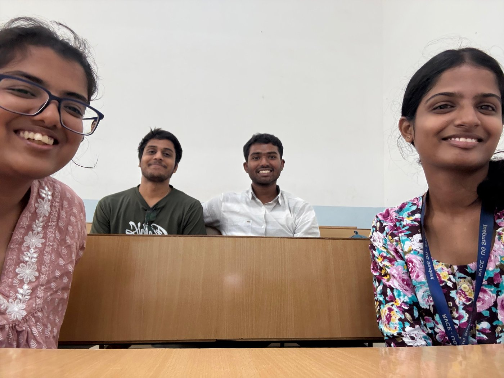<br><sub>The team, May 2026</sub></p>

**Khushi Choudki** and **Keerthi M** (Information Science and Engineering), **Tejas L**
and **Akula Uday Kiran** (Aerospace Engineering), RV College of Engineering, Bengaluru.
Guided by **Dr. Rachana S Akki**, Associate Professor.

## Timeline

| When | What |
|---|---|
| March 2026 | Synopsis: *Energy-Aware Digital Twin of LEO Satellite Constellations Using Scalable N-Body Simulation* |
| 23 April – 8 May 2026 | First STK scenario: five objects, ISS ephemeris, access and AER reports |
| 7–8 May 2026 | SWISSCUBE screened against STK's full catalogue |
| June 2026 | Project report; the software side's repository |
| 10 July 2026 | Final scenario: 33 satellites screened with AdvCAT; the report exported for the software side |
| November 2026 | This repository: the open-source re-creation, the 2017 element sets found, the screening redone |

The code is MIT-licensed. The STK scenario, screenshots and recordings are the
team's own work. The element sets come from CelesTrak and STK's bundled database.
